# CloudFordge on AWS: infrastructure as code

Production-style AWS infrastructure for **CloudFordge**, a Next.js cloud-certification practice platform, written twice from the same design: **Terraform** and **CloudFormation**. It runs the app on ECS Fargate behind an Application Load Balancer, with a Multi-AZ MySQL database, shared file storage, a managed image build, autoscaling and alarms.

The application itself lives in a separate private repository. This repo contains only the infrastructure.

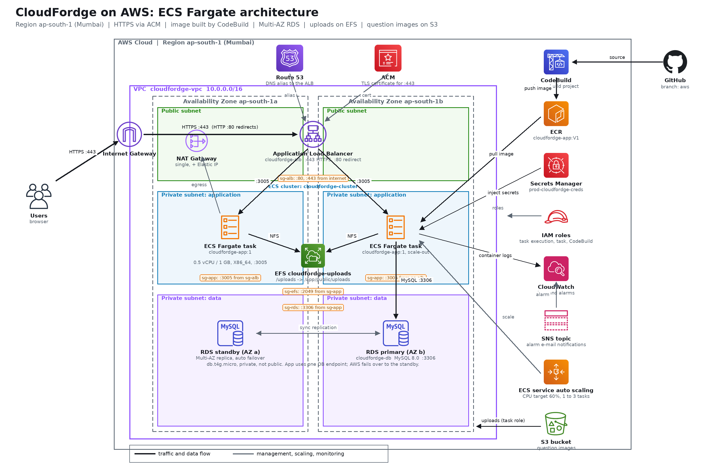

## What it builds

| Layer | Service | Notes |
|---|---|---|
| Network | VPC `10.0.0.0/16`, 2 AZs | Public, private-app and private-data subnets; one NAT gateway; S3 gateway endpoint. Data subnets have no internet route |
| Entry | Application Load Balancer | HTTP :80; HTTPS :443 and redirect when a domain or certificate is supplied |
| Compute | ECS on Fargate | 0.5 vCPU / 1 GB, X86_64, rolling deploys with circuit breaker and rollback, ECS Exec enabled |
| Database | RDS MySQL 8.0, Multi-AZ | `db.t4g.micro`, encrypted, private, password generated |
| Storage | EFS + access point | Uploads persist across task restarts (uid/gid 1001) |
| Images | ECR + CodeBuild | CodeBuild builds the Docker image from the app repo and pushes it to ECR |
| Secrets | Secrets Manager | `DATABASE_URL` and `NEXTAUTH_SECRET` injected into the task at start-up |
| Scaling | Application Auto Scaling | CPU target tracking at 60%, 1 to 3 tasks |
| Monitoring | CloudWatch + SNS | Logs, and 6 alarms (unhealthy hosts, 5xx, ECS CPU, RDS CPU, free storage, connections) |
| DNS / TLS | Route 53 + ACM (optional) | Certificate with DNS validation and alias record, enabled by setting a domain |
| Uploads | S3 bucket + task-role access | Private, encrypted; ready for the app's image storage |

Every taggable resource gets `Project`, `Environment`, `ManagedBy` and `Owner` tags.

## Design decisions

- **Security groups reference each other**, not IP ranges: only the ALB reaches the app, only the app reaches the database and EFS. Nothing but the ALB is reachable from the internet.
- **Database in isolated subnets** with no default route and public access off.
- **Secrets are generated** by the stack and injected by ECS; nothing sensitive sits in the task definition or the repo.
- **Least-privilege IAM:** separate task-execution and task roles, scoped to the one secret and the one bucket.
- **Safe first deploy:** the service starts with 0 tasks because no image exists yet. Deploy order is documented below.
- **Optional HTTPS:** off by default so the stack works with no domain. Set `domain_name` and `hosted_zone_id` (or `certificate_arn`) to turn it on.

## Repository layout

```
terraform/        Terraform (>= 1.9), one file per area
cloudformation/   single CloudFormation template, same stack
diagrams/         architecture diagram
screenshots/      the stack running in AWS
docs/             lessons learned
```

## Deploy with Terraform

Prerequisites: AWS CLI and Terraform >= 1.9, an AWS account, and credentials in a profile. Create the remote state once: an S3 bucket (versioned, encrypted, public access blocked) and a DynamoDB table with partition key `LockID`.

```bash
cd terraform
cp backend.hcl.example backend.hcl            # fill in your bucket and account
cp terraform.tfvars.example terraform.tfvars  # set github_repo_url and github_branch
terraform init -backend-config=backend.hcl
terraform plan
terraform apply                               # about 15 minutes, mostly Multi-AZ RDS
```

The service is created with `desired_count = 0`. Then:

1. **Build the image:** `aws codebuild start-build --project-name cloudfordge-image-build`. Wait for tag `v1` in ECR.
2. **Run the migration once:** `eval "$(terraform output -raw run_migration_command)"`. It creates the tables and seeds the data; check exit code 0 in the `/ecs/cloudfordge` log group.
3. **Start the app:** set `desired_count = 1` in `terraform.tfvars` and `terraform apply` again.
4. **Check it:** `curl "$(terraform output -raw app_url)/api/health"` returns `{"status":"ok"}`.

Tear down with `terraform destroy`. The ECR repository and S3 bucket are emptied automatically.

## Deploy with CloudFormation

```bash
aws cloudformation deploy --stack-name cloudfordge \
  --template-file cloudformation/cloudfordge.yaml \
  --capabilities CAPABILITY_NAMED_IAM \
  --tags Project=cloudfordge Environment=prod ManagedBy=cloudformation "Owner=Your Name" \
  --parameter-overrides GitHubRepoUrl=https://github.com/<your-user>/<your-app-repo>
```

Follow the same build, migrate and scale-up steps, using the stack outputs for the cluster, subnets and security group.

## Status

| Part | State |
|---|---|
| Terraform, HTTP-only on the ALB | Deployed end to end: plan, apply, image build, migration, healthy service |
| CloudFormation | Linted with `cfn-lint`; not deployed |
| HTTPS (ACM + Route 53) in both | Implemented; not deployed |

## Screenshots

The stack was first built by hand in the AWS Console to learn each service, then rewritten as code. The AWS Console screenshots below are from that first build, which has the same architecture. The last image is the Terraform apply that created the autoscaling target and policy. Account IDs, emails, endpoints and ARNs are masked.

| | |
|---|---|
| 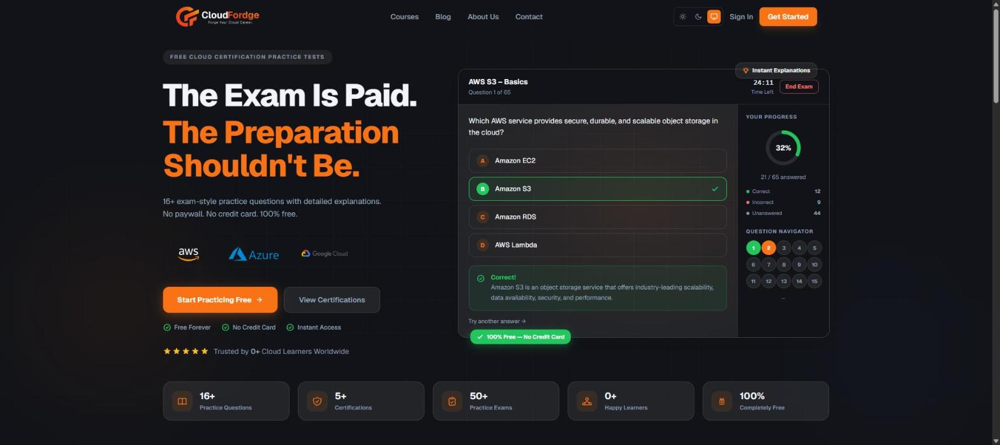 | 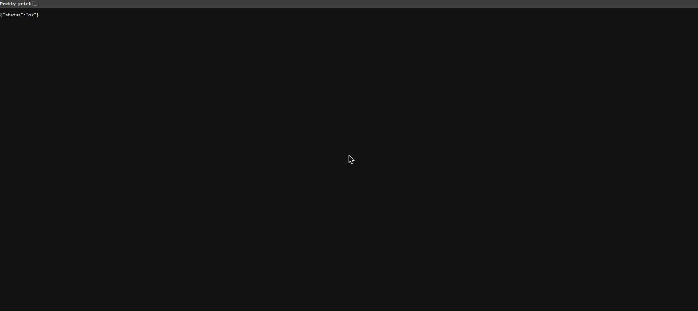 |
| 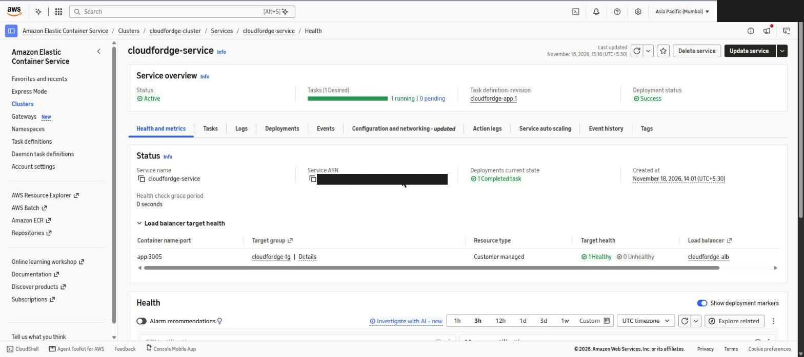 | 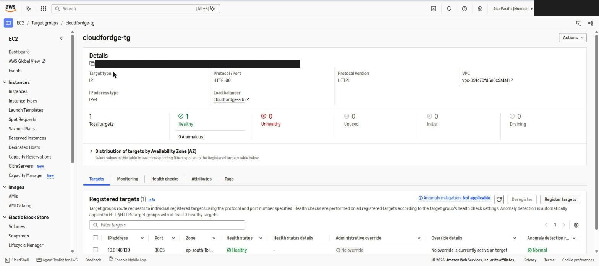 |
| 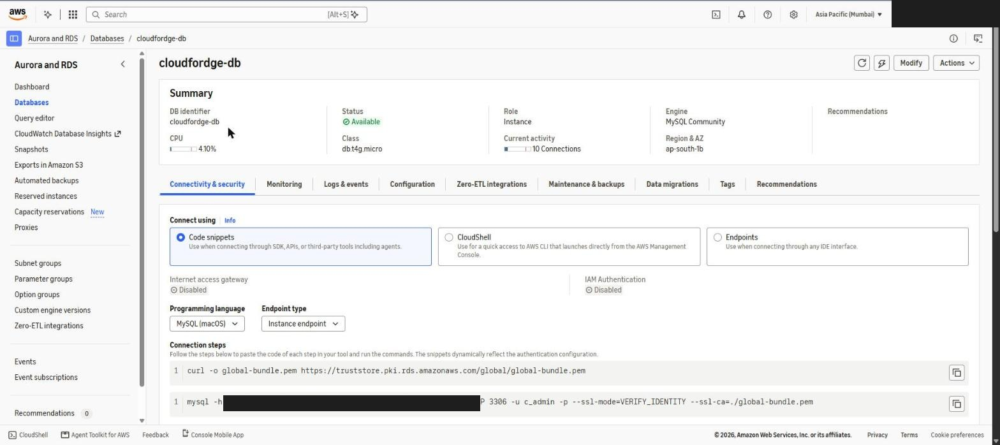 | 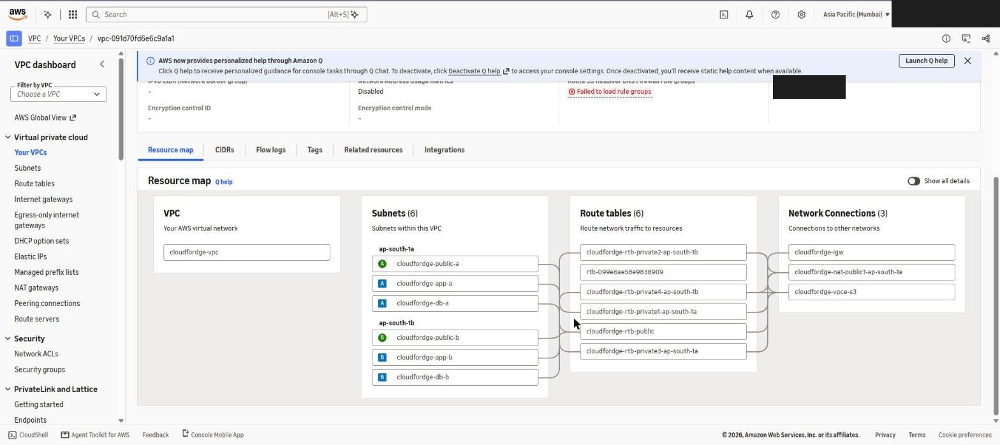 |
| 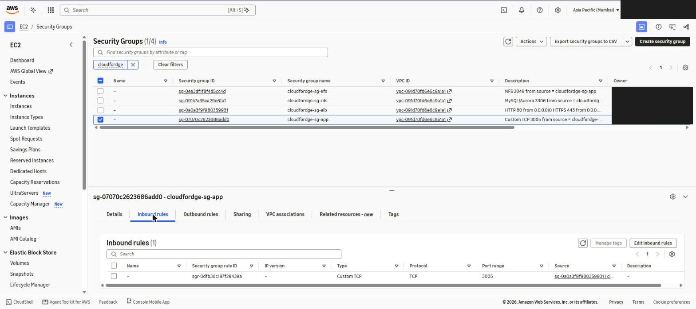 | 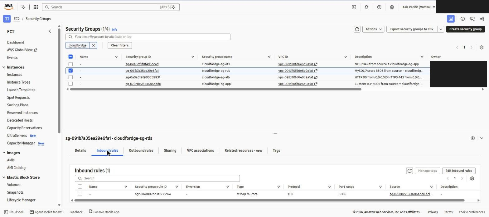 |
| 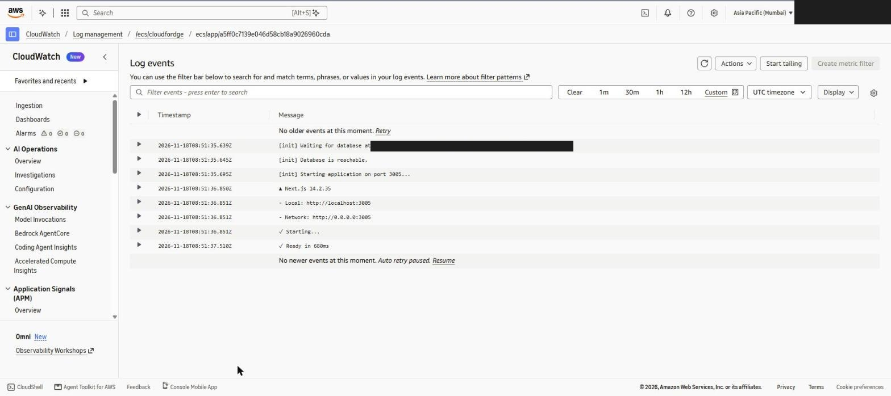 | 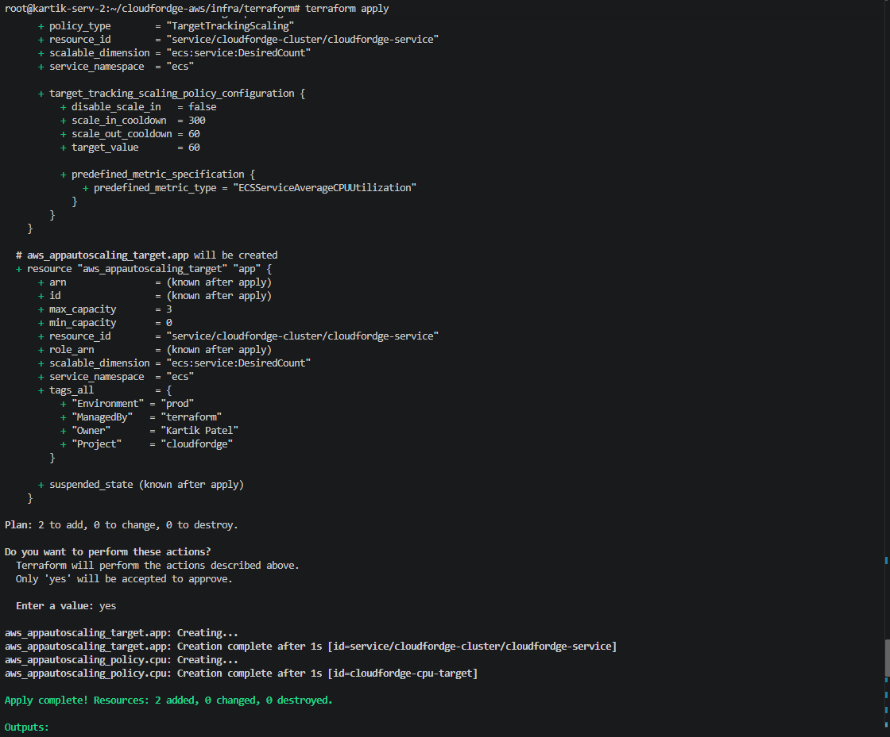 |

## Cost

The NAT gateway, Application Load Balancer, Multi-AZ RDS and Fargate task all bill by the hour. This is a practice stack: run `terraform destroy` when you finish.

## Lessons learned

See [docs/lessons-learned.md](docs/lessons-learned.md): a wrong database port, a health-check grace period set to zero, a build quota, and other problems met while building it, and how they were fixed.

## Roadmap

- Deploy and verify the HTTPS path with a real domain
- Move question images from Cloudflare R2 to S3 through the task role
- Move the in-memory rate limiter and cache to ElastiCache (Redis) for multi-task deployments
- A CI/CD pipeline that builds on push and deploys a new task definition

## License

MIT
